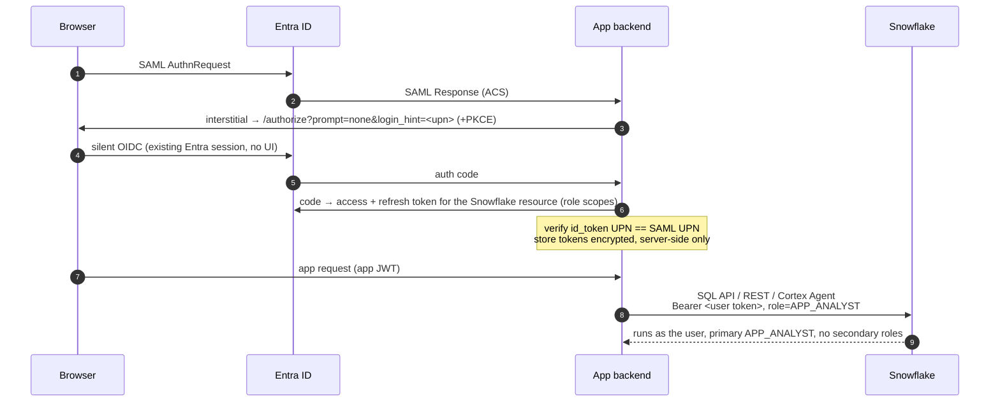
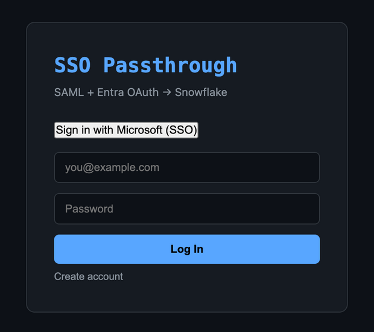
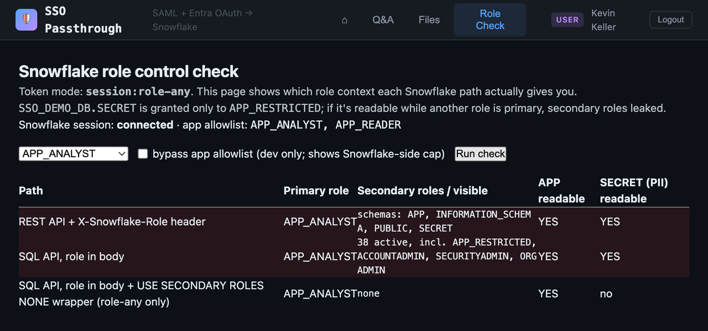
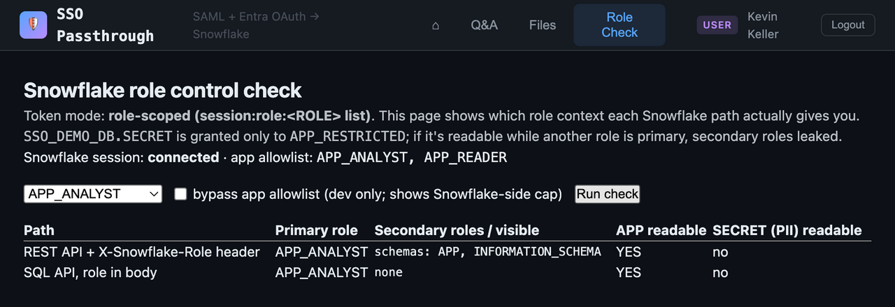
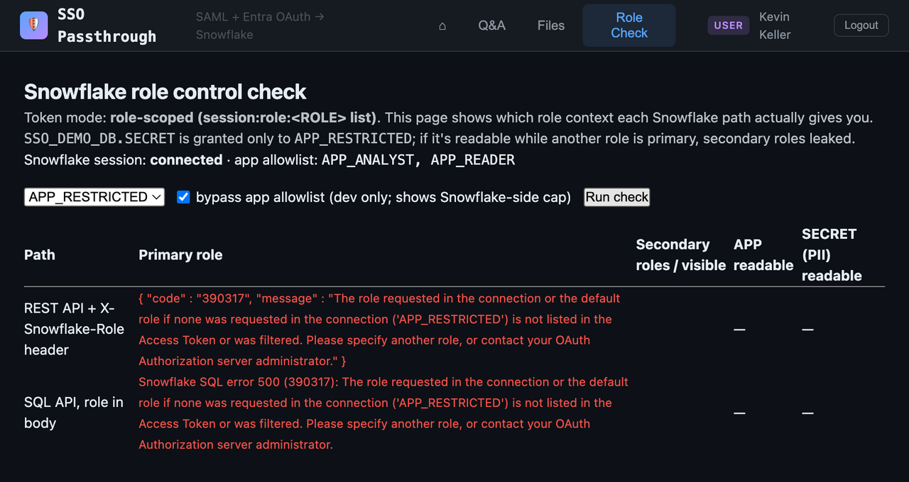
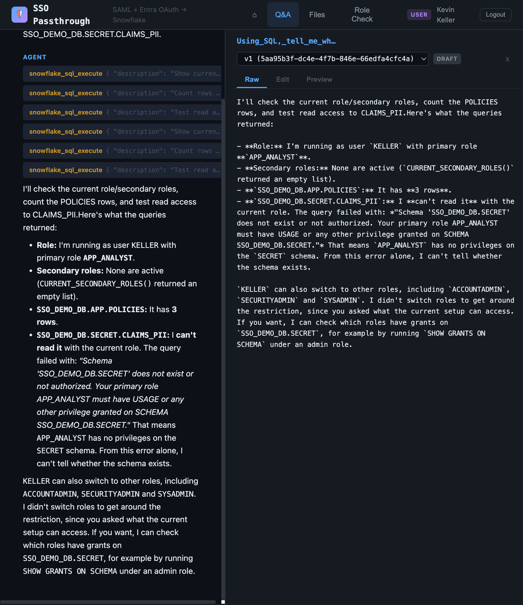

# Snowflake SAML → OAuth User Passthrough (Entra ID)

Your web app signs users in with **SAML** (Entra ID). This repo shows how it can then call **Snowflake as that user**, with:
- no extra login prompt;
- per-user RBAC and audit;
- Snowflake, not your app code, enforcing which roles the app may use.

It contains:
- **[`docs/GUIDE.md`](docs/GUIDE.md)**: the design guide (flow, token model, role control, backstops, alternatives);
- **[`app/`](app/)**: a working reference app (FastAPI + Preact). It covers the SAML SP, the silent OIDC hop, an encrypted per-user token store, SQL API / REST / Cortex Agent calls as the user, and a *Role Check* page that proves which roles are actually active;
- **[`setup/`](setup/)**: idempotent scripts that provision the Entra app registrations and the Snowflake integrations, roles and demo data.

> Community sample, not an official Snowflake product. Review it before using anything in production.

---

## The problem

- A SAML assertion **can't be exchanged** for an OAuth token in Entra ID. The app has nothing it can hand to Snowflake.
- The usual shortcut, a `session:role-any` token, has a trap. `EXTERNAL_OAUTH_ALLOWED_ROLES_LIST` caps only the **primary** role, so **every other role the user holds stays active as a secondary role**, ACCOUNTADMIN included.

## The approach



The recommended design (details in [GUIDE §0](docs/GUIDE.md#0-recommended-design)) has three parts:

1. **A silent OIDC hop chained onto the SAML ACS.** The user sees one login. The backend is a confidential client and holds the refresh token.
2. **A dedicated v2 resource app with role scopes** (`session:role:APP_ANALYST`, `session:role:APP_READER`):
   - Entra emits every *consented* scope, so the consent grant is the role allowlist.
   - With a role-scoped token, Snowflake **disables secondary roles itself** and rejects every other role.
3. **A second External OAuth integration on the v2 issuer.**
   - v2 tokens have a different issuer from v1, so this integration can coexist with an existing central Entra integration.
   - Its `ALLOWED_ROLES_LIST` is the after-the-fact control: **scope broadly in Entra once, enable and revoke roles in Snowflake any time.**

A `role-any` fallback (a v1 integration plus a per-request `USE SECONDARY ROLES NONE` wrapper or a session policy) is also included and demonstrated.

## What runs as whom

> **Every Snowflake call the app makes — including Cortex Agent inference and the SQL the agent generates — runs as the signed-in end user, under the role in their token. Nothing runs as a service account, and nothing falls back to the user's `DEFAULT_ROLE`.**

| Call | Auth | Snowflake user | Role (scoped mode) | Secondary roles |
|---|---|---|---|---|
| Role check / direct SQL (`/api/v2/statements`) | User's OAuth token (Bearer) and `"role"` in the request body | Signed-in user | `APP_ANALYST` (from `session:role:APP_ANALYST`) | Disabled by Snowflake |
| Cortex Agent inference (`agent:run`) | User's OAuth token (Bearer) and `X-Snowflake-Role` | Signed-in user | `APP_ANALYST` | Disabled by Snowflake |
| SQL generated by the agent's tool | Executed by the app through the SQL API with the **same user token** | Signed-in user | `APP_ANALYST` | Disabled by Snowflake |

Why the default role never comes into play:

- **The token itself fixes the role.** A `session:role:<R>` token gives a session with exactly role `<R>`.
  - If a request asks for any other role, Snowflake rejects it (error `390317`) instead of falling back to `DEFAULT_ROLE`.
  - Trying to turn secondary roles back on fails too: `USE SECONDARY ROLES` returns error `3107`.
- **The data is governed by the user's own grants.** Row access policies, masking policies and grants all see `CURRENT_USER()` = the end user and `CURRENT_ROLE()` = the scoped role.
- **Query history shows the end user.** `QUERY_HISTORY` lists every app query under the end user's name with `ROLE_NAME = APP_ANALYST`.
  - For example, the PII table query was attempted as `APP_ANALYST` and denied.
  - Verify it yourself:

```sql
SELECT start_time, user_name, role_name, query_type, LEFT(query_text, 80)
FROM TABLE(INFORMATION_SCHEMA.QUERY_HISTORY_BY_USER(USER_NAME => '<USER>'))
ORDER BY start_time DESC LIMIT 20;
```

**Caveat for `role-any` mode only.** The token does not fix a role here, so:

- The primary role is whatever the app requests, capped by `ALLOWED_ROLES_LIST`. If a request omits the role, `DEFAULT_ROLE` applies.
- Secondary roles default to **all** of the user's granted roles.
- The app therefore runs every query inside a `USE SECONDARY ROLES NONE` scripting block (or you attach a session policy).

Scoped mode needs none of this.

## Screenshots

**1. Sign-in.** One click. The SAML login and the silent OIDC hop run back to back, with no second prompt.



**2. The trap: a `role-any` token.** The app asks for `APP_ANALYST`, but 38 secondary roles stay active, including `APP_RESTRICTED` and `ACCOUNTADMIN`, and the PII schema is readable on both REST and the SQL API. Only the `USE SECONDARY ROLES NONE` wrapper closes it.



**3. Recommended: a role-scoped token.** Same user and same request. Snowflake runs with `APP_ANALYST` only: no secondary roles and no PII, on every path, with no wrapper.



**4. Snowflake enforces the boundary.** Even with the app's own allowlist bypassed, a role outside the token is rejected by Snowflake (390317).



**5. Cortex Agent as the user.** The agent's SQL tool runs with the user's token: primary role `APP_ANALYST`, no secondary roles, PII denied.



---

## Quick start

**Prerequisites:**
- an Entra tenant where you can create app registrations and grant admin consent;
- a Snowflake account with ACCOUNTADMIN;
- [`az`](https://learn.microsoft.com/cli/azure/), [`snow`](https://docs.snowflake.com/developer-guide/snowflake-cli/index), [`pixi`](https://pixi.sh) and Node.js;
- a Snowflake user whose `LOGIN_NAME` equals your Entra UPN.

**1. Entra.** This creates the scoped v2 resource app, the role-any v1 resource app and the SAML web app, then assigns you and grants admin consent:

```bash
az login --tenant <your-tenant>
./setup/entra_setup.sh                       # env: PREFIX, BASE_URL, ROLES, ENABLE_ROLE_ANY
```

It writes `setup/entra.env` (IDs) and `setup/.entra_secret` (client secret). Both are gitignored.

**2. Render the Snowflake SQL and the app config:**

```bash
(cd app && pixi install)
app/.pixi/envs/default/bin/python setup/render.py \
    --sf-account <ORG-ACCOUNT> --sf-user <SNOWFLAKE_USER_NAME> --mode scoped   # or role-any
```

**3. Snowflake.** This creates the roles `APP_ANALYST`, `APP_READER` and `APP_RESTRICTED`, the warehouse `SSO_DEMO_WH`, the database `SSO_DEMO_DB` (an `APP` schema plus a fake-PII `SECRET` schema), both integrations and an unattached session policy:

```bash
snow sql -c <connection> -f setup/snowflake_setup.sql
```

> Snowflake allows one integration per issuer. If your account already has an Entra **v1** integration, remove the `ENTRA_SSO_ROLE_ANY_V1` block and use `--mode scoped`.

**4. Run.** This starts Postgres, builds the frontend and serves the backend:

```bash
app/start.sh                                 # → http://localhost:9000
```

Click **Sign in with Microsoft (SSO)**, then open **Role Check**. To compare modes, re-run `render.py --mode role-any`, restart, and sign in again.

---

## Key findings

All of these are verified with real tokens; see [GUIDE §9](docs/GUIDE.md#9-validation-checklist).

| Finding | Consequence |
|---|---|
| `EXTERNAL_OAUTH_ALLOWED_ROLES_LIST` caps only the **primary** role | With `role-any`, all of the user's roles stay active as secondaries |
| Role-scoped token (`session:role:<R>`) | Snowflake disables secondaries on SQL API, REST and Cortex Agent; `USE SECONDARY ROLES` is refused (3107) |
| Entra emits **all consented scopes** for a resource | The admin-consent grant is your Entra-side role allowlist |
| Scope for a not-yet-existing role | Harmless. The role works once it's created **and** added to the integration allowlist, with no new token |
| v1 and v2 tokens have different issuers | A second integration is allowed (a same-issuer duplicate gives 003524). v2: `aud` = client-ID GUID, user claim `preferred_username` |
| SQL API **ignores `X-Snowflake-Role`** | Always send `role` in the request body (REST, MCP and Agent do honour the header) |
| Multi-statement child-result fetch uses `DEFAULT_ROLE` | Use a single `EXECUTE IMMEDIATE` scripting block for the role-any wrapper |
| Entra default SAML NameID is opaque | Take the UPN from the `.../claims/name` attribute, otherwise the `prompt=none` hop fails (AADSTS50058) |

## Repository layout

```
docs/GUIDE.md                     design guide
docs/images/                      screenshots
setup/entra_setup.sh              Entra app registrations (idempotent)
setup/snowflake_setup.sql.tmpl    Snowflake roles, demo data, integrations, session policy
setup/render.py                   entra.env → snowflake_setup.sql + app/config/config.toml
app/                              reference app (fork of nanocortex-web-agent)
  backend/app/api/auth_saml.py           SAML SP + silent OIDC + token hand-off
  backend/app/services/snowflake_oauth.py token store, refresh, run_sql (role / secondary-role control)
  backend/app/api/role_test.py           /api/poc/role-check
  backend/app/services/llm/cortex.py     Cortex Agent as the user
  frontend/src/pages/RoleCheck.jsx       Role Check page
```

## Not covered or not yet tested

- Safari, iOS and private-browsing behaviour of the silent hop
- Conditional Access sign-in frequency
- End-to-end logout across both sessions (implemented, not fully tested)
- Production hardening: secret storage, key rotation, HTTPS, multi-instance token store

## Cleanup

```sql
DROP INTEGRATION IF EXISTS ENTRA_SSO_SCOPED_V2;
DROP INTEGRATION IF EXISTS ENTRA_SSO_ROLE_ANY_V1;
DROP DATABASE IF EXISTS SSO_DEMO_DB;
DROP WAREHOUSE IF EXISTS SSO_DEMO_WH;
DROP ROLE IF EXISTS APP_ANALYST; DROP ROLE IF EXISTS APP_READER; DROP ROLE IF EXISTS APP_RESTRICTED;
```

```bash
for n in "SSO Passthrough Web" "SSO Passthrough Snowflake (scoped)" "SSO Passthrough Snowflake (role-any)"; do
  az ad app delete --id "$(az ad app list --display-name "$n" --query '[0].appId' -o tsv)"; done
```

## License

MIT. See [LICENSE](LICENSE). `app/` is derived from [nanocortex-web-agent](https://github.com/sfc-gh-kkeller/nanocortex-web-agent) (MIT).
